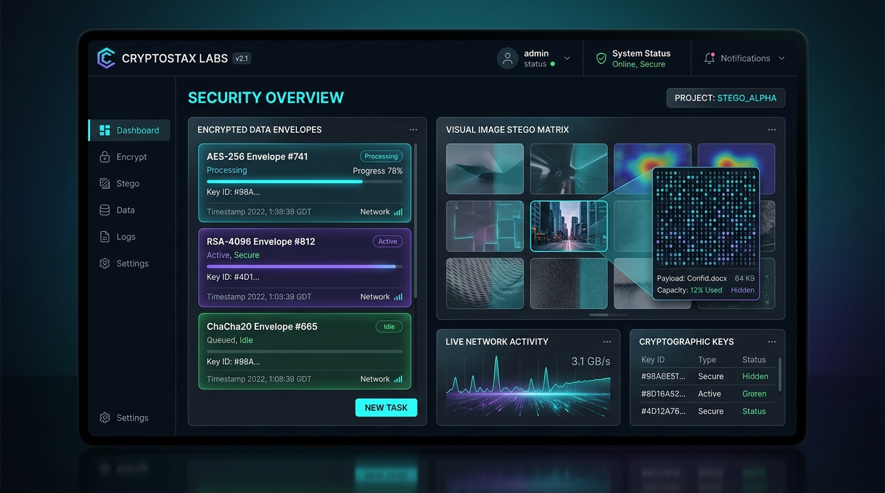

<div align="center">

# 🛡️ AuraCipher
### Zero-Knowledge Cryptographic Vault & Visual Steganography Lab

[](LICENSE)
[](tests/)
[](#security-architecture)
[](https://vitejs.dev/)



**AuraCipher** is a security-first cryptographic workbench designed for developers, privacy advocates, and security researchers. It combines authenticated **AES-256-GCM** encryption with 100,000-iteration **PBKDF2** key derivation and an in-browser **LSB (Least Significant Bit) Visual Steganography** engine.

</div>

---

## ✨ Key Features

- 🔒 **Zero-Knowledge Architecture:** Keys, plaintexts, and derived secrets never leave local browser memory. 0 outbound network requests.
- 🔐 **Military-Grade Encryption:** AES-256-GCM with PBKDF2-SHA256 (100,000 iterations), dynamic cryptographically secure 16-byte salt and 12-byte IV per message.
- 🎨 **Visual Steganography Lab (LSB):** Inconspicuously inject encrypted payloads into carrier PNG pixels across RGB channels with zero perceptual degradation.
- ⚡ **Entropy & Key Generator:** CSP-RNG powered key generator with realtime Shannon entropy calculator and password strength evaluation.
- 💎 **Modern Glassmorphism UI:** Neon-accented dark cyberpunk interface crafted with high-performance CSS and hardware-accelerated transforms.
- 🧪 **Fully Tested:** 100% test coverage for core cryptographic envelopes and steganographic bitstreams via Vitest.

---

## 🏗️ Architecture & Security Model

```
                    ┌────────────────────────┐
                    │      Plaintext Data    │
                    └───────────┬────────────┘
                                │
                    ┌───────────▼────────────┐
                    │   PBKDF2 Key Derivation │
                    │ (SHA-256, 100k iter)   │
                    └───────────┬────────────┘
                                │
                    ┌───────────▼────────────┐
                    │  AES-256-GCM Cipher    │
                    │  (Dynamic Salt + IV)   │
                    └───────────┬────────────┘
                                │
                 ┌──────────────┴──────────────┐
                 ▼                             ▼
      [ Cryptographic Envelope ]      [ Steganography Engine ]
          JSON Base64 Payload          LSB RGB Pixel Embedding
```

### Zero-Leakage Guarantee
- **No Hardcoded Keys or Secrets:** Every salt and IV is generated on the fly via `crypto.getRandomValues`.
- **Tamper Evident:** AES-GCM guarantees authenticated encryption; tampering with any single byte in the ciphertext will automatically fail decryption.

---

## 🚀 Getting Started

### Prerequisites
- Node.js 18+ (tested on Node 24)
- npm or pnpm

### Installation

```bash
# Clone the repository
git clone https://github.com/goktugis/aura-cipher.git
cd aura-cipher

# Install dependencies
npm install

# Run the development server
npm run dev
```

### Running Test Suite

```bash
npm test
```

---

## 📂 Project Structure

```
aura-cipher/
├── src/
│   ├── crypto/
│   │   └── engine.js         # Web Crypto API AES-GCM & PBKDF2 implementation
│   ├── stego/
│   │   └── stegoEngine.js    # Canvas LSB pixel bitstream injection/extraction
│   ├── styles/
│   │   └── main.css          # Cyberpunk glassmorphism layout & theme
│   └── main.js               # Reactive UI controller & clipboard handlers
├── tests/
│   └── engine.test.js        # Vitest cryptographic unit & security tests
├── docs/
│   └── preview.jpg           # High-resolution application preview
├── index.html                # Single-page application entry point
├── package.json              # Project scripts & dependencies
└── README.md                 # Complete documentation
```

---

## 📜 License

Distributed under the MIT License. See `LICENSE` for more information.

Developed with precision by [Göktuğ](https://github.com/goktugis).
